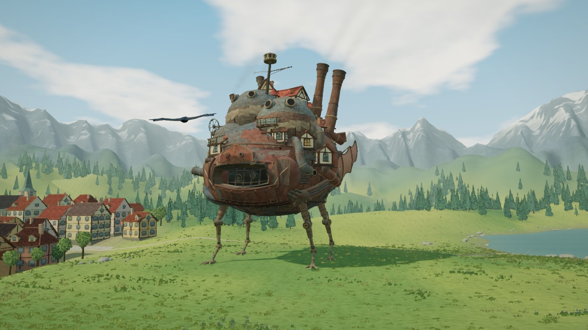

# 风起，城行

*Where the Wind Takes Us · Howl's Moving Castle*

一部以《哈尔的移动城堡》为灵感的程序化三维短片。随乌鸦掠过花田、城门和红屋顶小镇，看城堡穿行四季，迎着晨光与伙伴们再次相遇。



**Three.js r170 · Blender / Cycles · 60s · 1080p / 24fps**

## 体验作品

下载项目，使用支持 WebGL 2 的桌面浏览器打开 `index.html`，点击「跟随乌鸦」。

- **电影模式**：沿着完整的一分钟镜头游览城堡。
- **自由观景**：环绕城堡、缩放、切换四季与沿途场景。
- **播放控制**：暂停、重播、章节跳转、拖动时间轴，以及本地配乐选择。

网页为独立的离线 HTML，适合在 16:9 窗口观看。

## 制作流程

从程序化建模开始，为城堡的机械腿、翼帆、烟囱和角色设计独立运动；通过共享导演时间轴，将 Three.js 的实时场景导出到 Blender，使用 Cycles 完成原生材质、灯光、烟尘与最终画面。

| 目录 | 内容 |
| --- | --- |
| `src/` | 城堡、角色、地形、环境、步态与播放器 |
| `direction/` | 相机轨迹、起飞、昼夜转换与尾声 |
| `blender/` | 场景导出、动画重建、材质、渲染与后期脚本 |
| `scripts/` | 离线构建与时间轴测试 |
| `docs/` | 制作手记、分镜和逆向提示词 |

使用 Node.js 18 或更新版本即可重新构建网页：

```bash
npm run build
npm run check
npm test
```

## 制作文档

- [制作手记](docs/MAKING_OF.zh-CN.md)
- [分镜与时间线](docs/SHOT_LIST.zh-CN.md)
- [逆向提示词（短版 / 完整版）](docs/REVERSE_PROMPT.zh-CN.md)
- [Blender 制作流程](blender/README.md)

## Credits

创作：**N1n3VASthR33H** · AI-assisted procedural animation

灵感来自戴安娜·韦恩·琼斯的原著与宫崎骏执导的[《哈尔的移动城堡》](https://www.ghibli.jp/works/howl/)。

[素材与署名](docs/ASSETS_AND_CREDITS.md) · [第三方组件许可](THIRD_PARTY_NOTICES.md)
